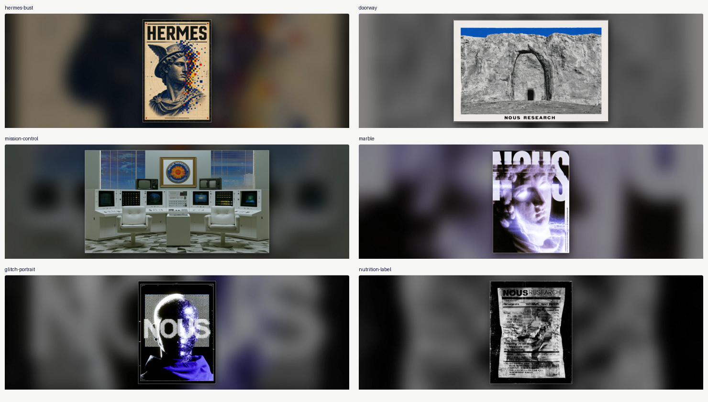
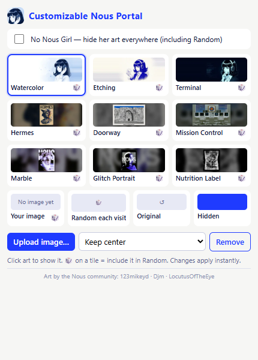
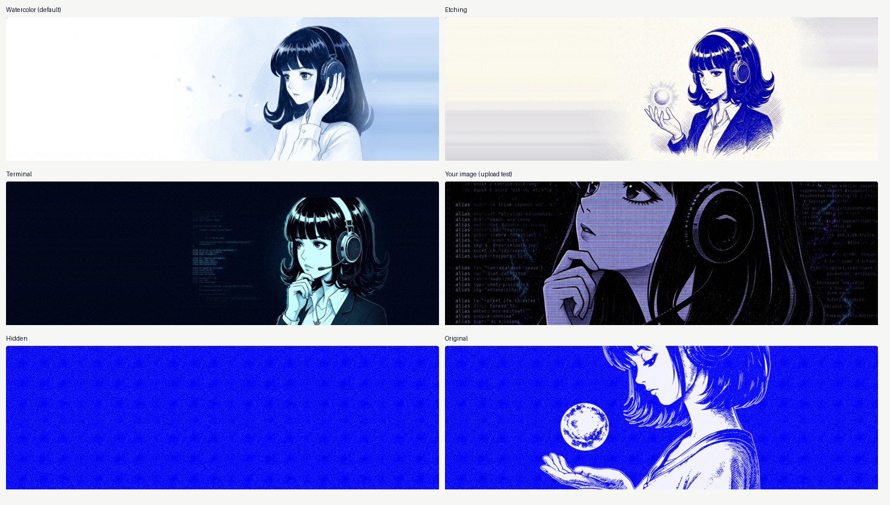

# Customizable Nous Portal

Pick your own art for the Nous Portal banner on [hermes-agent.nousresearch.com](https://hermes-agent.nousresearch.com/). It changes your browser only.

## Download
**[⬇ customizable-nous-portal-2.1.0.zip](https://github.com/123mikeyd/customizable-nous-portal/releases/download/v2.1.0/customizable-nous-portal-2.1.0.zip)** (Chrome, Edge, Brave, Opera, Vivaldi, Firefox 121+)

## Features
- **9 built-in pieces:** Nous Girl in Watercolor, Etching and Terminal styles, plus Hermes, Doorway, Mission Control, Marble, Glitch Portrait and Nutrition Label
- **No Nous Girl switch:** hides her art from the picker and from Random
- **Upload your own image:** it's cropped to the 3:1 banner and saved in your browser
- **Random each visit:** 🎲 on any tile adds it to or removes it from the rotation
- **Original** (the site's own art) or **Hidden** (a blank blue plate)
- Changes apply instantly. No tracking, no network requests, no accounts.

## Install

### Chrome / Edge / Brave / Opera / Vivaldi
1. Download the zip above and **unzip it**.
2. Open `chrome://extensions` (or `edge://extensions`, `brave://extensions`, `opera://extensions`).
3. Turn on **Developer mode**.
4. Click **Load unpacked** and pick the unzipped folder.
5. Pin the extension, then click its icon to choose your art.

### Firefox (121+)
- **Quick try:** open `about:debugging#/runtime/this-firefox`, click **Load Temporary Add-on…**, and pick `manifest.json` in the unzipped folder. It's removed when Firefox restarts.
- A permanent install needs a Mozilla-signed build, which isn't available yet.

Safari isn't supported yet.

## Nous Girl variants

## Credits
Art by Nous community members **123mikeyd**, **Djm** and **LocutusOfTheEye**, shared in the public Nous community channels. The artwork belongs to its creators.

Fan-made community project. Not affiliated with or endorsed by Nous Research.

## How it works
A content script finds the portal image by its `portal-art` filename, so a new CDN hash doesn't break it, and swaps the `src`. It also turns off the site's parallax and blend effects so full-colour art displays correctly. A MutationObserver re-applies your choice if the page re-renders. Source is in [`extension/`](extension/); the art list is in `extension/catalog.js`.
